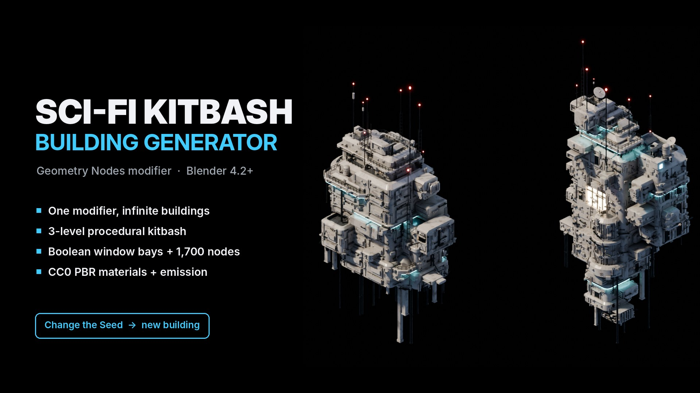

# SciFi Kitbash Building Generator – product page

Product page and documentation for **SciFi Kitbash Building Generator**, a Geometry Nodes modifier for Blender that generates sci-fi kitbash buildings from a Seed. This repository holds only the description, documentation and media, not the .blend file.

- Product page: `index.html`, served with GitHub Pages at https://blenderprocedural.github.io/scifi-kitbash/
- Documentation: `docs.html`, served at https://blenderprocedural.github.io/scifi-kitbash/docs.html
- Images: `images/` (cover, renders, parameter and preset sheets, UI screenshot, logo)
- Video and GIF loops: `media/`
- Shared style and iframe helper: `assets/`. Fonts (Inter) are bundled in `fonts/`, so the pages make no external requests.

Both pages work inside an iframe. Links to other pages open in a new tab, and the page posts its height to the parent window (`{type: "scifi-kitbash-height", height}`).

